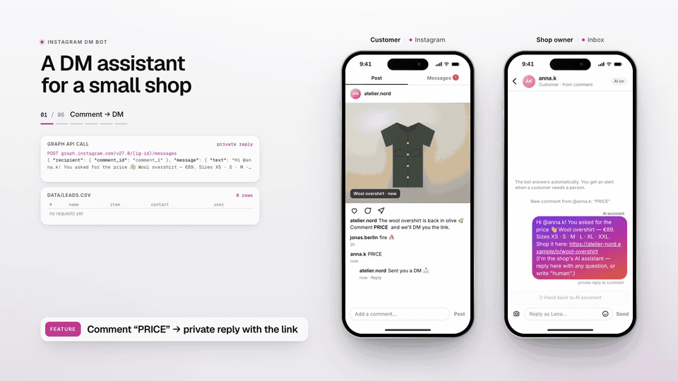
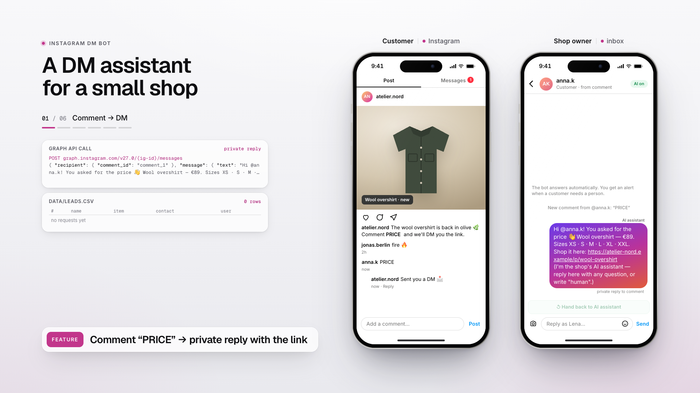
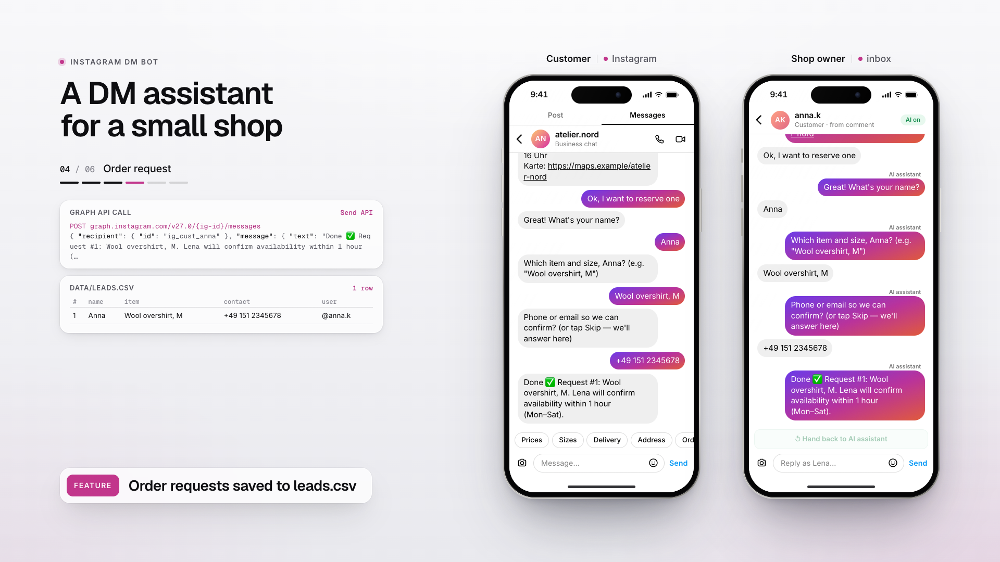
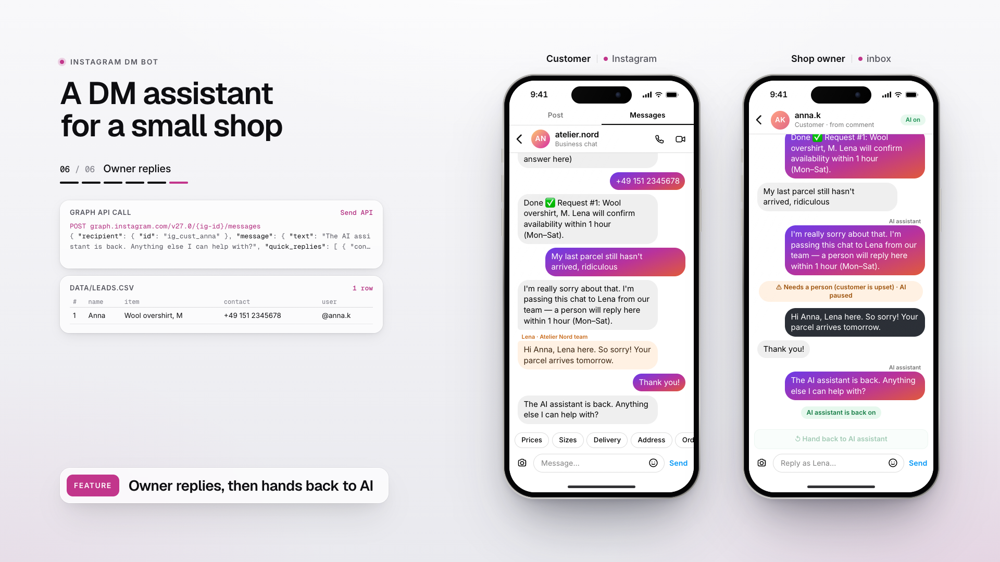
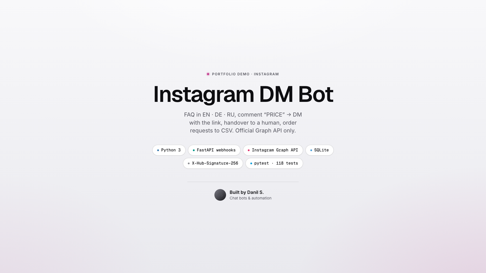

# Instagram DM Bot for a Small Shop

An auto-responder for Instagram Direct, built for a small clothing store or a salon. It answers common questions, sends the product link by DM when someone comments **PRICE**, hands the chat to a person when a customer is upset, and saves order requests to CSV. It uses the **official Instagram Platform (Graph API) only**.



▶️ **Full demo video (about 51 s, 1080p 60 fps):**

https://github.com/user-attachments/assets/a75c90cc-a860-4208-abc9-da0d094db5c4

| Comment → DM | FAQ + request → CSV |
|---|---|
|  |  |
| **Handover to a human** | **Summary** |
|  |  |

## What it does
- **FAQ:** prices (for one product or the whole list), sizes with a size chart, delivery and returns, address and opening hours. It understands free text ("how much is the jeans?", "Wo ist euer Laden?", "А есть в XL?") and quick-reply buttons. One message can get several answers ("price and sizes of the linen shirt").
- **Comment "PRICE" → DM:** a comment containing the keyword (whole word, any case; `PRICE`, `PREIS` and `ЦЕНА` by default) triggers a **private reply**, a DM sent to the commenter by `comment_id`. The DM carries the price and the link for the product on that post. A short public reply ("Sent you a DM 📩") is optional. Rules from Meta are built in:
  - one DM per comment, and only one per person per post
  - the reply must go out within 7 days of the comment
  - limit of 750 private replies per hour
  - the bot never replies to its own comments and ignores webhook retries
- **Handover to a human:**
  - When the customer is upset (EN/DE/RU complaint words, or a long message in CAPS), the bot apologises, pauses itself, and alerts the owner (log, plus an optional JSON webhook for Slack, Telegram, Make or n8n). The customer can also just write "human", "Mensch" or "человек".
  - If the owner answers from the Instagram inbox, the bot notices the echo and goes quiet automatically.
  - The bot comes back when the owner hands the chat back (`POST /admin/resume/{igsid}`) or after `HANDOVER_TIMEOUT_H` hours (default 12).
- **Order requests → CSV:** asks for the name, the item and size, and a phone or email (the contact can be skipped). Each request goes to SQLite and `data/leads.csv`, which has a UTF-8 BOM so it opens cleanly in Excel or Google Sheets. Cells are protected against formula injection.
- **Languages:** EN / DE / RU, detected from every message. Neutral text such as "ok" or "M" keeps the current language.
- **EU AI Act (art. 50):** the first message, including the private reply, says *"I'm the AI assistant of …" / "Ich bin der KI-Assistent …" / "Я ИИ-ассистент …"* and explains how to reach a person.
- **Safe by default:**
  - `X-Hub-Signature-256` is checked on every webhook, and unsigned requests are rejected even when no secret is configured.
  - Messages are de-duplicated by `mid`.
  - The 24-hour window is enforced before every send.
  - Text is cut to 1,000 bytes, with at most 13 quick replies of 20 characters each.
  - Keys come only from `.env`.

## Architecture
```
app/
  graph.py     Instagram Platform client: webhook parse (messages, echoes, quick replies, comments in both
               Instagram-Login and Facebook-Login shapes), signature check, Send API, private replies, limits
  engine.py    conversation logic: intents EN/DE/RU, complaint detection, handover, request form, comment rules
  i18n.py      texts + language detection
  db.py        SQLite: users (language, bot/human mode, form state, last message), dedupe, comments, leads, handovers
  leads.py     CSV export
  main.py      FastAPI: GET/POST /webhook, /admin/resume, /admin/leads, emulator API
  emulator.py  local emulator API: builds the same webhook JSON Meta sends, reads back the exact Graph API calls
  shop.json    the business: products, prices, links, sizes, delivery, address, hours, post → product map
demo/index.html  local Instagram-style emulator (neutral design): customer phone (post + DMs) + owner inbox
tests/           118 pytest checks, Graph API mocked with httpx.MockTransport
tests/data/messages.jsonl  54 realistic customer messages (EN/DE/RU) with the expected answer type
scripts/record_demo.py     Chrome screencast + ffmpeg → demo.mp4 + screenshots
```
For a salon, edit `shop.json` (services instead of products). For another messenger, keep `engine.py` and write a new client like `graph.py`.

## Run locally (no Meta account needed)
```bash
python3.12 -m venv .venv && .venv/bin/pip install -r requirements.txt
.venv/bin/python -m pytest -q                                    # 118 passed
DB_PATH=/tmp/igdemo.db LEADS_CSV=/tmp/igdemo.csv DEMO_MODE=1 \
  .venv/bin/uvicorn app.main:app --host 127.0.0.1 --port 8092
open http://127.0.0.1:8092/demo/
.venv/bin/python scripts/record_demo.py                          # re-record the video (own temp DB)
```
In demo mode, with no `IG_ACCESS_TOKEN` set, all Graph API calls go to an in-process fake. Nothing leaves the machine. The emulator's "Graph API call" panel shows the exact request body the bot would send.

**Tests cover:**
- the webhook handshake
- signatures: wrong secret, missing, tampered body, no `sha256=` prefix, Unicode body, secret not configured
- duplicate deliveries
- the 24-hour window
- private replies: both payload shapes, keyword matching, language, the 7-day limit, the 750/h limit, no spam, own comments
- handover: complaint, request for a human, owner echo, admin token, timeout, owner alert webhook
- the request form and CSV, including formula injection
- 54 real-style messages in three languages

## Go live
1. The client needs an **Instagram professional account** (Business, or Creator). In the Instagram app, under *Settings → Messages and story replies → Message controls → Connected tools*, turn on **Allow access to messages**.
2. Create a Meta app (type *Business*) and add the **Instagram** product. Choose one setup:
   - **Instagram API with Instagram Login** (`IG_LOGIN_TYPE=instagram`, `graph.instagram.com`). No Facebook Page needed. Permissions: `instagram_business_basic`, `instagram_business_manage_messages`, `instagram_business_manage_comments`.
   - **Instagram API with Facebook Login** (`IG_LOGIN_TYPE=facebook`, `graph.facebook.com`). The IG account must be linked to a Facebook Page and you use a Page token. Permissions: `instagram_basic`, `instagram_manage_messages`, `instagram_manage_comments`, `pages_manage_metadata`, `pages_show_list`, `pages_read_engagement`.
3. Deploy behind HTTPS. Set the webhook to `https://<host>/webhook` with your `IG_VERIFY_TOKEN`, then subscribe to `messages`, `messaging_postbacks` and `comments`. Fill in `.env` from `.env.example` and keep `DEMO_MODE=0`. For EU clients, use EU hosting and sign a DPA (AV-Vertrag): DMs are personal data.
4. Test with accounts that have a role on the app (Standard Access). For the client's real customers, the app needs **App Review (Advanced Access) + Business Verification**.

## Platform notes (checked 19.11.2026)
- **Official API only.**
  - Unofficial libraries (instagrapi, instabot, Selenium or "phone farm" automation) break Instagram's Terms of Use. Instagram detects them and the account gets **action-blocked, restricted or disabled**, often with no appeal.
  - Bulk unsolicited DMs, follow/DM tools and scraped lists are not allowed through any route.
  - This bot only **answers** people who wrote first or commented first.
- **Account and setup.**
  - The Instagram Platform works only with **professional accounts**. The old Basic Display API for personal accounts was shut down on 4 Dec 2024.
  - **Instagram Login** (since 2024) needs no Facebook Page.
  - **Facebook Login** (the classic Messenger Platform path) needs a **Business/Creator account linked to a Facebook Page**. That path also supports Page-level tools such as the Handover Protocol (conversation routing).
  - Meta also lists a "Unified Login" setup with system-user tokens for business integrations.
- **24-hour window.**
  - You can message a person only after they message you, and free-form replies are allowed for **24 hours after their last message**.
  - A conversation started from a Click-to-Direct ad can get up to 7 days.
  - The **`HUMAN_AGENT` tag** lets a *human* reply within 7 days. It needs the Human Agent permission through App Review and must not be used for automated messages.
  - No promotional pushes outside the window. The bot checks the window before every send, and the owner's handback message is blocked if the window has closed (tested).
- **Private replies (comment → DM).**
  - You can send **one** message to the commenter, addressed by `comment_id`, **within 7 days** of the comment.
  - For Instagram Live comments, the reply must go out during the broadcast.
  - Further messages are allowed only after the person answers, then the normal 24-hour window applies.
  - Comment webhooks need **Advanced Access** and the app in **Live** mode.
- **Rate limits** (Meta's Messenger Platform rate-limit page):
  - Send API: **300 calls/s** per IG professional account for text, links, reactions and stickers; 10 calls/s for audio and video. Many messages into one thread can also be throttled.
  - Private replies: **750 calls/hour** for comments on posts and reels; 100/s for Live comments.
  - Conversations API: 2 calls/s.
- **Message format.** Text is UTF-8 and at most **1,000 bytes**. Quick replies: at most **13**, text only, titles up to 20 characters. They are not shown on desktop, so the bot also understands typed text.
- **Webhooks.**
  - The verification `GET` uses `hub.mode`, `hub.verify_token` and `hub.challenge`.
  - Every `POST` is signed: `X-Hub-Signature-256: sha256=HMAC-SHA256(app secret, raw body)`.
  - Meta retries failed deliveries for up to **36 hours**, so de-duplication is required. Webhooks are not stored on Meta's side.
- **App Review.**
  - Standard Access covers accounts you own or manage, and testers with a role on the app.
  - Serving a client's account in production needs **Advanced Access** for each permission (screencast + use-case description) and **Business Verification** of the business that owns the app. Allow from a few days to a few weeks.
  - A common setup: the client's own Business Manager owns the app.
- **Cost.** The Instagram Messaging API itself has no per-message fee (unlike WhatsApp). The costs are hosting and setup.
- **AI disclosure.** EU AI Act art. 50 (transparency for AI systems talking to people) applies from 2 Aug 2026 on the original timeline; check for later EU changes. The bot says it is an AI assistant in the first message and offers a person.

## Not included on purpose
- Unofficial Instagram clients, mass DMs, follow/unfollow, scraping.
- Payments (a Stripe/Shopify checkout link can be added to `shop.json`) and an LLM answer layer (an easy hook in `engine.handle` for the "unknown" branch).

## License
MIT. See [LICENSE](LICENSE).
